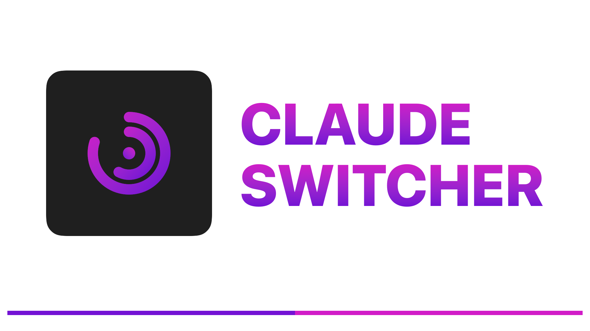
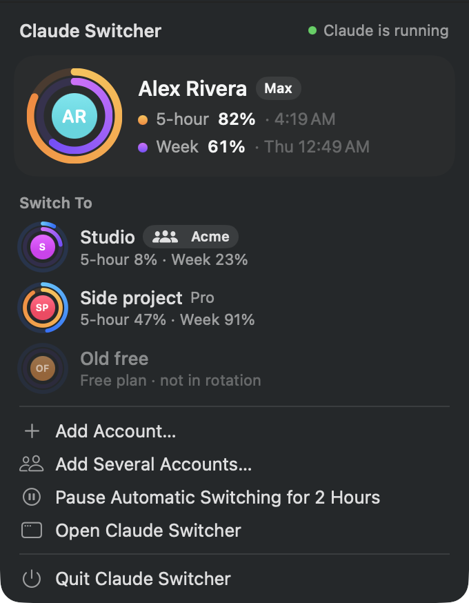
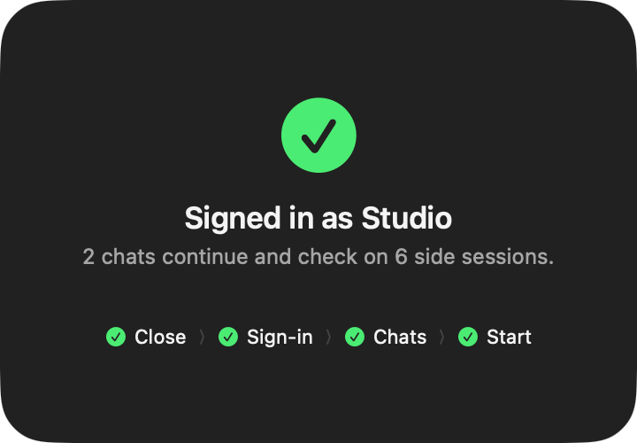
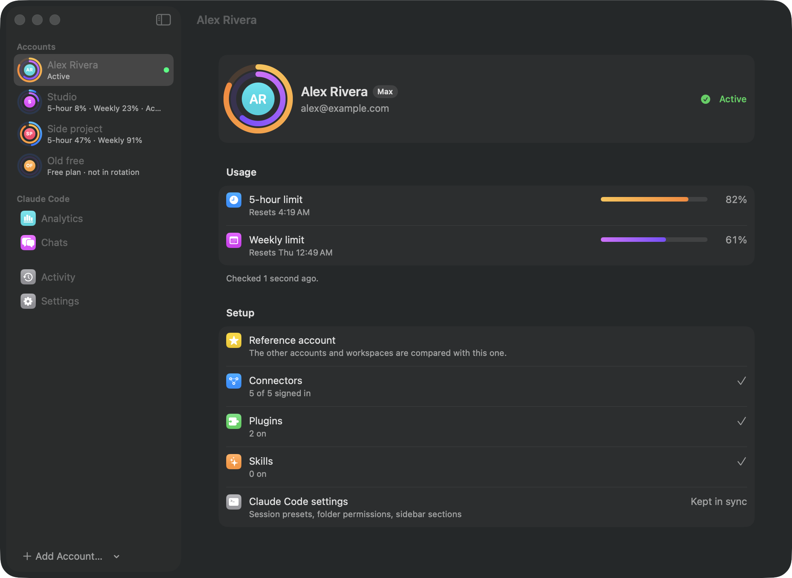
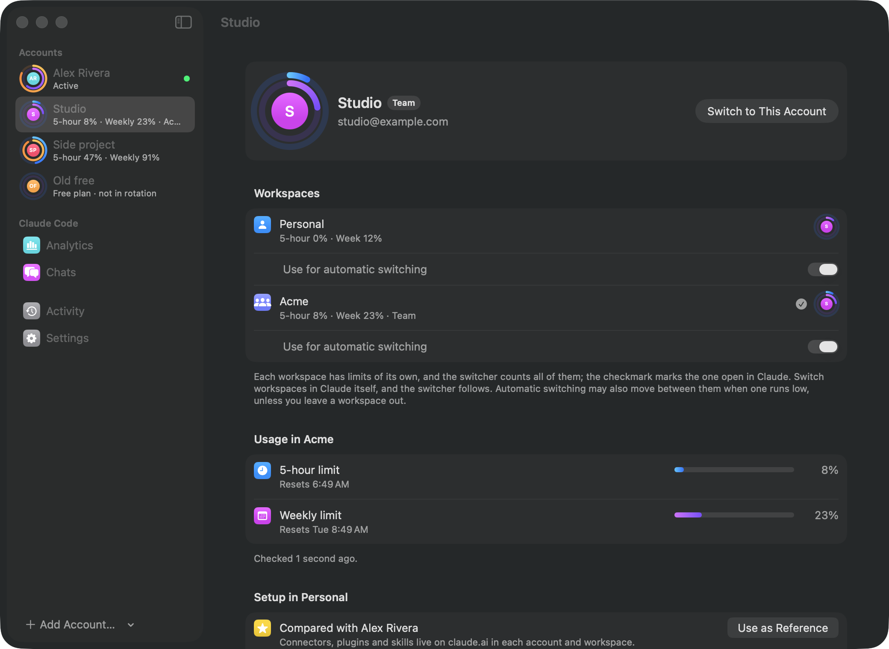
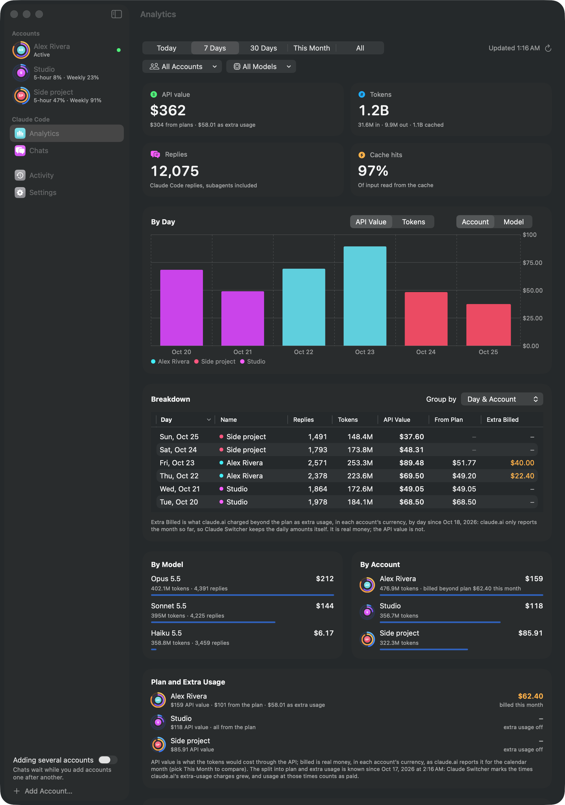
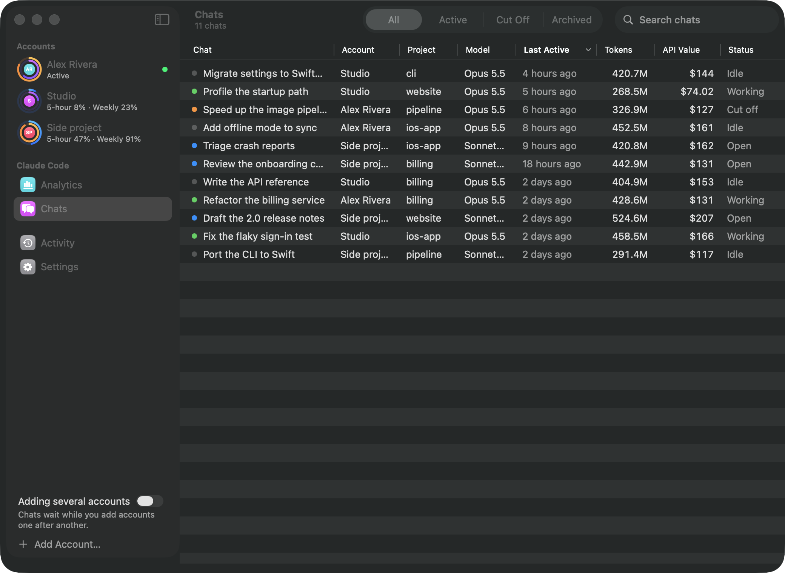
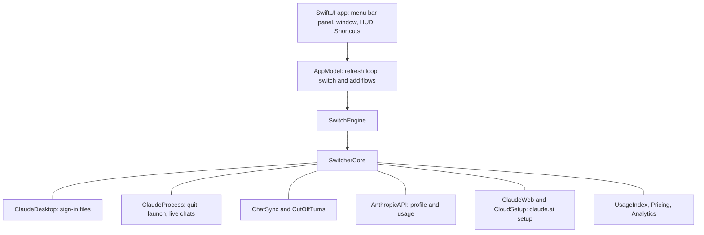
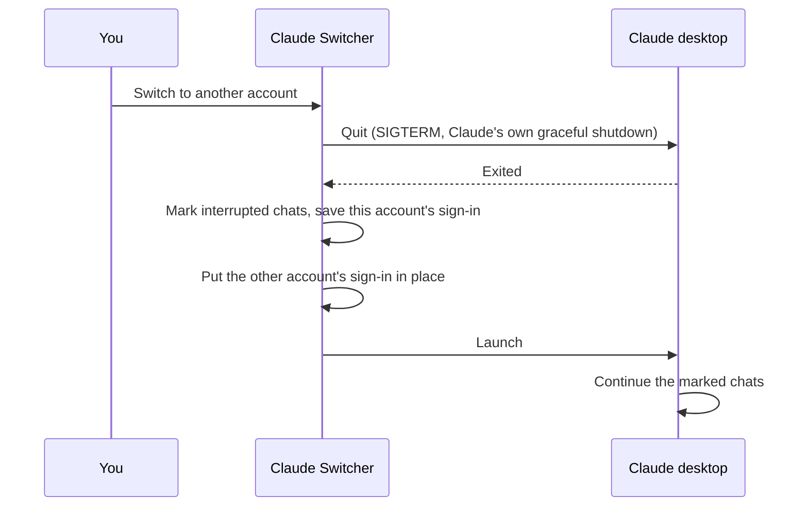

<a id="top"></a>

<p align="center">
  
</p>

<h1 align="center">🔁 Claude Switcher</h1>
<p align="center"><em>A native macOS menu bar app that switches the Claude desktop app between accounts. Your chats, projects and running work come along.</em></p>

<p align="center">
    <a aria-label="ElsiKora logo" href="https://elsikora.com">
  
</a>      
</p>

> [!NOTE]
> Claude Switcher is an unofficial tool. It is not made by, affiliated with or endorsed by Anthropic. "Claude" is a trademark of Anthropic.

## 💡 Highlights

- 🔁 One click switches Claude to another account. The app quits Claude cleanly, swaps the saved sign-in and opens Claude again.
- 🧵 Chats, projects and Claude Code sessions are the same in every account. Work that a switch cuts off continues by itself after the restart.
- 📊 Both limits of every account live in the menu bar with when they run out at your pace, and Claude Switcher can switch for you before they do, as rarely as it can.
- 💸 Analytics shows what your Claude Code usage would cost at API prices, what your plans covered and what extra usage paid for, by day, model, account and chat.

<p align="center">
  
  &nbsp;
  
</p>

## 📚 Table of Contents

- [Description](#-description)
- [Tech Stack](#-tech-stack)
- [Features](#-features)
- [Screenshots](#-screenshots)
- [Architecture](#-architecture)
- [Project Structure](#-project-structure)
- [Prerequisites](#-prerequisites)
- [Installation](#-installation)
- [Usage](#-usage)
- [Privacy and Security](#-privacy-and-security)
- [Roadmap](#-roadmap)
- [FAQ](#-faq)
- [License](#-license)
- [Acknowledgments](#-acknowledgments)

## 📖 Description

The Claude desktop app is signed in to one account at a time. When you have more than one account, for example a personal and a work plan, changing accounts means signing out, signing in again, and losing the chats and running work of the other account.

Claude Switcher keeps a saved sign-in for every account you add. A switch quits Claude the way Claude quits itself, puts the other account's sign-in in place, and opens Claude again. Claude Code chats and projects are kept in one shared list, so every account sees the same chats. Chats the restart interrupted are marked the way Claude marks them on its own quit, so Claude continues them on launch.

It runs in the menu bar, reads each account's 5-hour and weekly limits from Anthropic, and suggests the account with the most room left.

### Real-World Use Cases

- **Several plans, one Mac**: keep a personal and a work subscription, and move between them without signing out.
- **Long agent runs**: when one account's 5-hour limit runs out mid-task, switch and let the same chats continue on the next account.
- **Weekly limits that would go unused**: move to an account whose week resets soon, so its remaining usage is not lost.
- **Knowing what you use**: see how many tokens Claude Code used, on which model and account, and what it would have cost at API prices.

## 🛠️ Tech Stack

| Category          | Technologies                                                      |
| ----------------- | ----------------------------------------------------------------- |
| **Language**      | Swift 6 (strict concurrency, warnings as errors)                  |
| **UI**            | SwiftUI, Liquid Glass, Swift Charts, AppKit for the HUD panel     |
| **Platform**      | macOS 26, `MenuBarExtra`, `SMAppService`, App Intents, UserNotifications |
| **Core library**  | `SwitcherCore`, a Swift package with no third-party dependencies  |
| **Storage**       | JSON files, SQLite (read-only, for Claude's cookie store), CommonCrypto |
| **Testing**       | Swift Testing                                                     |
| **Build**         | XcodeGen, `xcodebuild`                                            |

## 🚀 Features

- ✨ **One-click switch**: quits Claude cleanly (the same shutdown as quitting it yourself), swaps the sign-in and opens Claude again.
- ✨ **Add Account**: restarts Claude on its sign-in screen and keeps your current sign-in. Sign in with the other account and Claude Switcher picks it up.
- ✨ **Add Several Accounts**: chats a restart cuts off wait while you add accounts one after another; press Done on the last one and every waiting chat continues there.
- ✨ **Shared chats and projects**: every account's Claude Code chat list holds the same chats. Chats you deleted stay deleted.
- ✨ **Work continues after a switch**: chats that were mid-turn, running a command, or waiting on a background agent are marked as interrupted. Claude continues the main chats, and they check on their side sessions.
- ✨ **Live limits**: both limits of every account, as rings in the menu bar and the window, with their reset times and when they run out at the pace of the last checks.
- ✨ **Automatic switching** (optional), built to switch rarely, since every switch makes each open chat read its context again in the new account:
  - before the limit runs out at the current pace, or at your threshold at the latest; earlier on an account with extra usage on;
  - to the account whose free room would reset unused first, never to one that is already billing extra usage;
  - at a pause between replies when there is still room, waiting three minutes at most;
  - to an account whose week resets within a day, only when that week is worth clearly more than the switch costs;
  - paused for two hours with one click.
- ✨ **Same setup everywhere**: compares each account's connectors, tool permissions, plugins and skills on claude.ai with a reference account. Copy Setup adds what is missing, and only runs when you click it.
- ✨ **Workspaces**: an account in a team shows its Personal and Team workspaces, each with its own limits and its own setup; automatic switching counts every workspace, and you can leave one out. Switch workspaces in Claude, and the switcher follows.
- ✨ **Free accounts stay out of the way**: an account without a plan Claude Code runs on is marked Free and never rotated to.
- ✨ **Claude Code settings in sync**: session presets, folder permissions and sidebar sections follow you from one account to the next.
- ✨ **Analytics**: tokens, replies, cache hits and API-price value:
  - filtered by account and model, for today, 7 or 30 days, this month or all time;
  - a breakdown table by day, account, model or chat, sortable by every column;
  - what each plan covered and what extra usage paid for, and what claude.ai billed beyond each plan by day, in that account's currency.
- ✨ **Chats**: one table of every Claude Code chat across accounts. It shows status, project, model, tokens and API value, and opens a chat in Claude with a double click.
- ✨ **Shortcuts and Siri**: *Switch Claude Account*, *Switch to the Account with the Most Room* and *Get Claude Usage*.
- ✨ **Notifications**: when a limit resets, an account passes 90%, extra usage billed today passes an amount you set, or an account is billing with nowhere to move; and a morning summary of the day before.
- ✨ **A regular Mac app**: Dock icon, a window that stays, the menu bar panel, Settings… (⌘,) and Check for Updates… in the app menu.
- ✨ **Names follow claude.ai**: a new name, email or plan shows up within half an hour.
- ✨ **Safety backup**: before the first switch, Claude's chat lists, projects and the files a switch touches are copied. Every switch also keeps a backup of the files it changes.

## 📸 Screenshots

> All screenshots use the built-in demo mode (`--demo`): made-up accounts and chats.

<p align="center">
  
</p>

<p align="center">
  
</p>

<p align="center">
  
</p>

<p align="center">
  
</p>

## 🏗 Architecture

### System Architecture



### A Switch, Step by Step



## 📁 Project Structure

```
Claude-Switcher/
├── App/ClaudeSwitcher/        # SwiftUI app: menu bar panel, window, HUD, intents
├── Sources/SwitcherCore/      # Switching, chat sync, usage, analytics (no UI)
├── Tests/SwitcherCoreTests/   # Swift Testing suite for SwitcherCore
├── Resources/                 # App icon (Icon Composer) and string catalog
├── docs/assets/               # Logo and screenshots
├── docs/dmg/                  # DMG window background, 1x and 2x
├── scripts/
│   ├── build-app.sh           # Build, and with --install put it in /Applications
│   ├── make-dmg.sh            # Pack the built app into build/Claude-Switcher.dmg
│   ├── dmg-settings.py        # DMG window layout (dmgbuild)
│   ├── render-dmg-background.swift
│   └── render-logo.swift      # Renders docs/assets/logo.png
├── project.yml                # XcodeGen project definition
├── Package.swift              # SwitcherCore package
├── LICENSE                    # Apache License 2.0
└── NOTICE
```

## 📋 Prerequisites

- macOS 26 or later
- The [Claude desktop app](https://claude.ai/download)
- To build from source: Xcode 26 and [XcodeGen](https://github.com/yonaskolb/XcodeGen) (`brew install xcodegen`)

## 🛠 Installation

### From a Release

1. Download `Claude-Switcher.dmg` from the [latest release](https://github.com/ElsiKora/Claude-Switcher/releases/latest) and open it.
2. Drag **Claude Switcher** onto **Applications**.
3. The build is signed ad hoc and not notarized, so macOS blocks it the first time. Open it once, then go to **System Settings → Privacy & Security** and click **Open Anyway**.

A `.zip` of the app is attached to each release too.

### From Source

```bash
git clone https://github.com/ElsiKora/Claude-Switcher.git
cd Claude-Switcher
scripts/build-app.sh --install
```

`scripts/build-app.sh` generates the Xcode project, builds a Release app into `build/`, and with `--install` replaces `/Applications/Claude Switcher.app` and opens it.

To pack it as a disk image like the releases (needs `pip install dmgbuild`):

```bash
scripts/make-dmg.sh
```

### Development Setup

```bash
swift test                     # SwitcherCore tests
xcodegen generate              # then open ClaudeSwitcher.xcodeproj
```

Run the app with `--demo` to see the interface with made-up accounts, without touching Claude:

```bash
"build/Claude Switcher.app/Contents/MacOS/ClaudeSwitcher" --demo --select=analytics
```

## 💡 Usage

### First Account

Open Claude Switcher while Claude is signed in. The account shows up within a minute.

> [!IMPORTANT]
> The first read asks for access to **Claude Safe Storage** in your keychain. That is the key Claude encrypts its sign-in with, and Claude Switcher needs it to read the sign-in. Click **Always Allow**.

### More Accounts

Click **Add Account…**. Claude restarts on its sign-in screen and your current sign-in is kept. Sign in with the other account. Claude Switcher adds it and brings your chats and projects into it.

> [!WARNING]
> Never use **Sign Out** in Claude to change accounts: it ends the saved sign-in on Anthropic's side, and that account has to be added again.

### Switching

Click an account in the menu bar panel or in the window. The HUD shows each step: Close, Sign-in, Chats, Start. Chats that were working when Claude quit continue on their own once it is open again.

### Automatic Switching

In **Settings → Automatic Switching** you can turn on:

- **Switch when nearly full**: before the active account's limit runs out at the pace of its last checks (or at the threshold you pick, at the latest), Claude Switcher moves to the account whose free room would reset unused first, else the one with the most room. It only picks an account well below the threshold, never one already billing extra usage, and waits at least 10 minutes between automatic switches. When there is still room, it waits for a pause between replies, three minutes at most.
- **Use up expiring weeks**: when another account's week resets within a day with half or more left, Claude Switcher moves there once your chats have been idle for 15 minutes and no command is running, if that week is worth at least three times re-reading every open chat. A switch by hand pauses this for 5 hours.

**Pause Automatic Switching for 2 Hours** is in the menu bar panel and in Settings.

### Adding Several Accounts

Choose **Add Several Accounts…** in the menu bar panel, or from the arrow next to **Add Account…** in the window. Sign in to one account after another with **Add Another**: chats a restart cuts off wait instead of continuing, and nothing switches on its own. Press **Done** on the account they should continue in; Claude restarts once and continues them all there.

### Workspaces

When an account belongs to a team, its page shows a **Workspaces** section: its own plan (Personal) and each Team or Enterprise workspace, with the limits of each. A checkmark marks the one Claude has open. Switch workspaces in Claude itself; Claude Switcher follows. Automatic switching counts every workspace and may move Claude between them when one runs low; turn off **Use for automatic switching** under a workspace to leave it out. Free workspaces and accounts without a plan Claude Code runs on are shown but never rotated to.

### Connectors

Connectors, plugins and skills live in a workspace on claude.ai, so each workspace has its own Setup section, compared with the reference you pick (any account or workspace). **Copy Setup…** adds what is missing, then reads claude.ai again and says what is there. New connectors are signed in to in Claude, under Customize → Connectors.

### Command Line

```bash
"/Applications/Claude Switcher.app/Contents/MacOS/ClaudeSwitcher" --status
```

Prints every saved account with its usage, then exits.

## 🔒 Privacy and Security

- Sign-ins stay on your Mac, in `~/Library/Application Support/Claude Switcher`.
- Access tokens are sent only to `api.anthropic.com`, to read each account's profile and usage. The claude.ai session cookie is sent only to `claude.ai`, to read and copy connectors, plugins and skills.
- The update check, which you can turn off, reads this repository's latest release from `api.github.com`. Nothing else leaves your Mac: no analytics, no telemetry.
- Analytics is read from Claude Code's own transcripts in `~/.claude/projects` and stays local.
- Copy Setup changes an account on claude.ai, so it only runs when you click it and confirm.

## 🛣 Roadmap

| Task / Feature                                          | Status         |
| ------------------------------------------------------- | -------------- |
| One-click switch with graceful quit and relaunch        | ✅ Done        |
| Shared chats and projects across accounts               | ✅ Done        |
| Continue interrupted chats and background work          | ✅ Done        |
| Live limits, suggestions and automatic switching        | ✅ Done        |
| Connector, plugin and skill setup from a reference      | ✅ Done        |
| Analytics and the all-chats table                       | ✅ Done        |
| Shortcuts, notifications, start at login                | ✅ Done        |
| Forecast-driven switching, pause, plan vs extra usage   | ✅ Done        |
| Personal and Team workspaces, setup per workspace       | ✅ Done        |
| Desktop and Notification Center widgets                 | 🚧 In Progress |
| Signed and notarized releases                           | 🚧 In Progress |

## ❓ FAQ

<details>
<summary><strong>Does it work with Claude Code in the terminal?</strong></summary>

Claude Switcher switches the Claude desktop app. Analytics and the chat list also read the Claude Code transcripts in `~/.claude/projects`, so terminal sessions count toward the totals.

</details>

<details>
<summary><strong>Will a switch interrupt my running agents?</strong></summary>

Claude has to restart to change accounts, so running turns stop. Before the restart, Claude Switcher marks every chat that was working, running a command, or waiting on a background agent. After the restart, Claude continues the main chats, and they check on their side sessions.

</details>

<details>
<summary><strong>What is "API value"?</strong></summary>

It is what the same tokens would cost through the Anthropic API, priced per reply with that reply's model. A subscription does not charge this. What claude.ai billed beyond a plan (extra usage) is shown separately, in the account's currency.

</details>

<details>
<summary><strong>Why does macOS ask for my keychain after an update?</strong></summary>

Builds are signed ad hoc, so each new build counts as a new app for the keychain. Click **Always Allow** once per build.

</details>

<details>
<summary><strong>Can I undo everything?</strong></summary>

Before the first switch, Claude Switcher copies Claude's chat lists, projects and the files a switch touches to `~/Library/Application Support/Claude Switcher/safety-backup`. Every switch also keeps a backup of the files it changes in `backups/`.

</details>

## 🔒 License

This project is licensed under the **Apache License 2.0**. See [LICENSE](LICENSE) and [NOTICE](NOTICE).

## 🙏 Acknowledgments

- Built and maintained by [ElsiKora](https://github.com/ElsiKora)
- Based on [claude-account-switcher](https://github.com/SnlperStripes/claude-account-switcher) by SnlperStripes (Apache-2.0). The file layout it relies on, the switch rules and the chat import follow that project; the code and the interface are new.
- Charts by [Swift Charts](https://developer.apple.com/documentation/charts), project generation by [XcodeGen](https://github.com/yonaskolb/XcodeGen)

---

<p align="center">
  <a href="#top">Back to Top</a>
</p>
